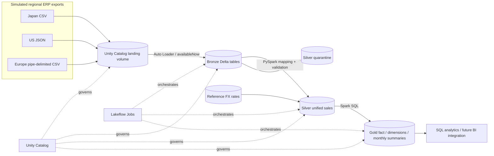

# Global ERP Sales Lakehouse — Azure Databricks

> **Status:** Planned / in progress · **Target demo:** December 1, 2026 · **Project type:** Personal technical proof of concept (synthetic data only)

Build an end-to-end Azure Databricks lakehouse that integrates sales exports from three simulated regional ERP systems. The goal is to demonstrate practical **Databricks, PySpark, Delta Lake, Auto Loader, Unity Catalog, and Lakeflow Jobs** skills in a scenario resembling an international manufacturer's data platform.

This is a **small, working implementation**, not a production ERP replacement. The emphasis is on implementing the core pipeline and proving its behavior with repeatable tests.

## Why this project?

Enterprise integration experience with NiFi, Kafka/Flink, SQL, and Azure infrastructure transfers well to this role. This project concentrates on the **new tools and execution patterns**: ingesting files through Auto Loader; operating Delta tables; building Spark transformations; maintaining curated, governed datasets; and orchestrating them through Databricks Jobs.

### Demonstration goals

1. Ingest differing regional file formats *incrementally* into Bronze tables.
2. Clean and map their fields into a *single canonical sales schema* in Silver.
3. Validate data, quarantine bad records, and use *idempotent Delta MERGE* to process corrections.
4. Publish dimensional Gold tables and regional/monthly sales summaries.
5. Run the whole Bronze → Silver → Gold → Validate workflow as a single Databricks Job.

## Architecture



**Important:** A **scheduled or manual Job** initiates `availableNow` ingestion; a file upload does *not* immediately start processing by itself. Continuous ingestion and file-arrival triggers are optional future extensions.

## Stack and conventions

| Layer / concern | Choice | Rationale |
|---|---|---|
| Cloud | Microsoft Azure | Matches target enterprise environment |
| Development & compute | Azure Databricks | Central tool being learned |
| Processing | PySpark + Spark SQL | Transformations, dimensional modeling, checks |
| Incremental file reads | Auto Loader (`cloudFiles`) | Stateful discovery with per-source checkpoints |
| Lakehouse storage | Delta Lake / managed Unity Catalog tables | Transactions, MERGE, table governance |
| Landing & state files | Unity Catalog managed volumes | Simple POC, avoids legacy DBFS root |
| Orchestration | Lakeflow Jobs | Explicit DAG, retries, run history |
| Source control | GitHub + Databricks Git folders | Reviewable notebook/code history |
| BI | Gold SQL queries | Power BI / Fabric are **future** consumers, not implemented |

The project uses the following **logical three-part names**:

- Catalog: `global_erp_dev` (or an available writable catalog if creation is restricted).
- Schemas: `bronze`, `silver`, `gold`, `reference`, `ops`.
- Managed volumes: `global_erp_dev.ops.landing` and `global_erp_dev.ops.pipeline_state`.

**Landing paths:** `/Volumes/global_erp_dev/ops/landing/jp/`, `/us/`, `/eu/`. **Checkpoint/schema paths:** separate per region under `/Volumes/global_erp_dev/ops/pipeline_state/`. Do not store checkpoints inside incoming source directories.

## Source systems

| ERP | File convention | Important differences |
|---|---|---|
| `ERP_JP` | UTF-8 CSV with Japanese column names | `yyyy/MM/dd`, JPY, Japanese headers; Shift-JIS is stretch work |
| `ERP_US` | Newline-delimited JSON with nested product object | `MM-dd-yyyy`, USD, camelCase keys |
| `ERP_EU` | UTF-8 pipe-delimited CSV | `dd.MM.yyyy`, EUR, blank/null variants |

Each record represents **one order line**, not an entire order. A line is identified by `(source_system, order_id, order_line_id)`; IDs only need to be unique *within* their originating ERP. Synthetic data includes valid rows, invalid rows, duplicates, and later corrections. The full schema and fixtures are in [Data contracts](docs/DATA_CONTRACT.md).

### Target tables

| Table | Responsibility |
|---|---|
| `bronze.erp_jp_raw` / `erp_us_raw` / `erp_eu_raw` | Append-only source-shaped rows + audit metadata |
| `reference.fx_rates` | Deterministic historical FX rates, USD per 1 local-currency unit |
| `reference.products` | Small canonical product lookup |
| `silver.global_sales_unified` | One latest valid record per composite business key |
| `silver.sales_quarantine` | Invalid records with reason and source metadata |
| `gold.fact_sales` | Clean sales facts suitable for analysis |
| `gold.dim_product` / `gold.dim_region` | Stable lookup dimensions |
| `gold.v_monthly_regional_sales` | Revenue, line count and units by month and region |

The MVP intentionally excludes inventory turnover; an inventory metric would require separate stock snapshots and a defensible definition.

## Milestones and timeline

| Milestone | Target | Primary outcome | Guide |
|---|---|---|---|
| **M1 — Setup & fixtures** | Nov 21–22 | Workspace, catalog/volumes, GitHub, source datasets | [M1](docs/milestones/01-setup-and-data.md) |
| **M2 — Bronze ingestion** | Nov 23–24 | Auto Loader creates 3 regional Delta tables | [M2](docs/milestones/02-bronze-ingestion.md) |
| **M3 — Silver processing** | Nov 25–27 | Canonical schema, FX, quarantine, idempotent MERGE | [M3](docs/milestones/03-silver-transformation.md) |
| **M4 — Gold modeling** | Nov 28 | Fact/dimensions and monthly revenue analytics | [M4](docs/milestones/04-gold-modeling.md) |
| **M5 — Jobs & presentation** | Nov 29–30 | Single job DAG, test evidence, interview-ready demo | [M5](docs/milestones/05-orchestration-and-demo.md) |

**Recommended build order:** get **one Japan CSV** through Bronze → Silver → Gold early, then add US and EU. If time becomes tight, protect the working end-to-end path and idempotency test before adding polish.

## Repository structure

```text
global-erp-databricks/
├── README.md
├── .gitignore
├── docs/
│   ├── DATA_CONTRACT.md
│   ├── INTERVIEW_DEMO.md
│   └── milestones/
│       ├── 01-setup-and-data.md
│       ├── 02-bronze-ingestion.md
│       ├── 03-silver-transformation.md
│       ├── 04-gold-modeling.md
│       └── 05-orchestration-and-demo.md
├── config/             # configuration templates (planned)
├── src/                # Python generator / reusable transforms (planned)
├── notebooks/          # Databricks notebooks or .py notebook source (planned)
├── tests/              # deterministic assertions / fixture tests (planned)
├── data/               # tiny sample fixtures; no secrets or enterprise data
└── assets/             # architecture and interview screenshots (planned)
```

The provided starting package contains the **documentation and empty scaffolding**, not completed pipeline source code. Implementation files will be added as each milestone is built.

## Getting started

1. Create a **dedicated Azure resource group** for the PoC; enable a budget/alerts, and check trial eligibility before launching paid compute.
2. Create a Unity Catalog-enabled Azure Databricks workspace, and choose the **smallest compatible compute** available for your scenario. Prefer short on-demand sessions.
3. Clone this repository in Databricks **Git folders** (previously called Repos) or work locally and commit to GitHub.
4. Follow **[Milestone 1](docs/milestones/01-setup-and-data.md)** to establish names, paths, and fixtures.
5. Implement milestones sequentially; capture test output and screenshots as you progress.

### Cost and credential safety

- Azure budgets send **notifications, not hard spending limits**, and cost telemetry can lag. Set a personally comfortable budget and inspect actual spending daily.
- Check whether **Trial (Premium – 14-day DBUs)** is available for your new workspace. Trial credits may cover Databricks DBUs but not all related Azure resource charges.
- Use small files (hundreds of rows), minimal/single-node or serverless compute **where supported**, short auto-termination on classic compute, and on-demand job execution. Shut down unused compute and SQL warehouses.
- Do **not** leave continuous streaming, file-arrival jobs, or high-frequency scheduled jobs running during the PoC. Don't create unnecessary VMs, public IPs, networking appliances, or external storage resources.
- Keep access tokens, keys, subscription identifiers, connection strings, and corporate data out of commits and screenshots. Never assume reimbursement without checking company policy.
- After the demo, explicitly inspect and remove any billable resources you no longer need. Deleting workspace resources can delete data; retain the GitHub source and approved screenshots first.

## Acceptance criteria

- [ ] All three regional source files load into Bronze using Auto Loader.
- [ ] Adding new uniquely named files and rerunning ingestion processes **only new files**.
- [ ] Silver has exactly one latest valid row per `(source_system, order_id, order_line_id)`.
- [ ] Invalid records are represented in a quarantine table, not silently discarded.
- [ ] Same-input rerun preserves Silver row count, key uniqueness, and Gold totals.
- [ ] Later corrected transactions update Silver and Gold revenue appropriately.
- [ ] All valid transactions have matching transaction-date FX rates and accurate `DECIMAL` conversion.
- [ ] Gold fact/dimension tables and monthly regional summary have passing assertions.
- [ ] A single Lakeflow Job runs the complete Bronze → Silver → Gold → validation flow.
- [ ] GitHub README, architecture diagram, and test evidence are ready to show.

## Out of scope

Real ERP connectors, production CDC, Kafka/Flink, Snowflake, actual Power BI/Fabric connectivity, inventory turnover, cross-region IAM/PII masking, robust CI/CD, and production SLA/monitoring. These are credible **future improvements**, not implied working features.

## Interview demonstration

See [Interview demo runbook](docs/INTERVIEW_DEMO.md) for the 3–5 minute walkthrough, screenshots, and honest framing of what is simulated versus implemented.

## Official documentation

- [Azure Databricks workspace/trial setup](https://learn.microsoft.com/en-us/azure/databricks/getting-started/free-trial)
- [Unity Catalog volumes](https://learn.microsoft.com/en-us/azure/databricks/data-governance/unity-catalog/create-volumes)
- [Auto Loader schema and checkpoints](https://learn.microsoft.com/en-us/azure/databricks/ingestion/cloud-object-storage/auto-loader/schema)
- [Auto Loader production and `availableNow` guidance](https://learn.microsoft.com/en-us/azure/databricks/ingestion/cloud-object-storage/auto-loader/production)
- [Delta Lake MERGE](https://learn.microsoft.com/en-us/azure/databricks/delta/merge)
- [Lakeflow Jobs](https://learn.microsoft.com/en-us/azure/databricks/data-engineering/jobs/jobs)
- [Databricks Git folders](https://learn.microsoft.com/en-us/azure/databricks/repos/git-operations-with-repos)
- [Azure cost budgets and alert limitations](https://learn.microsoft.com/en-us/azure/cost-management-billing/costs/tutorial-acm-create-budgets)

---

**Project authenticity note:** All sources are generated test data. No claim is made that this PoC has been deployed in a production ERP environment, that Databricks has been used professionally, or that downstream Fabric integration has been implemented.
