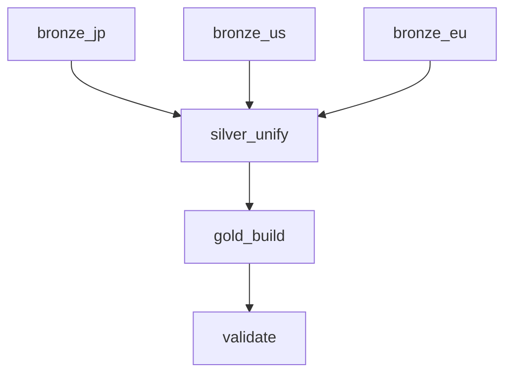

# M5 — Lakeflow Jobs, end-to-end verification, and interview demonstration

**Target:** November 29–30, 2026  
**Depends on:** M1–M4  
**Outcome:** One reproducible multi-task Databricks Job with a passing validation step, a clean GitHub repo, and a concise December 1 demo.

## Goal

Turn individually successful notebooks into a single clearly orchestrated **DAG**. This is where you show you can hand off a working implementation, not just an experimental notebook. Spend the final day preparing evidence, not adding new platforms.

## Workflow design

**Run mode:** manual triggering by default; optionally schedule one low-frequency execution if useful to demonstrate scheduling. Each Bronze task uses Auto Loader with `availableNow=True`, terminates, and retains its checkpoint. Silver reads current Bronze history, derives latest valid version per key, merges the final state, and rebuilds its quarantine snapshot. Gold deterministically rebuilds reporting tables. Validation asserts invariants and fails loudly if they are violated.

## Task checklist

### A. Build the Job

- [ ] Open **Jobs & Pipelines → Create → Job** in Azure Databricks.
- [ ] Name the job `global-erp-lakehouse-pipeline`.
- [ ] Add `bronze_jp`, `bronze_us`, `bronze_eu` notebook tasks, passing source-specific inputs.
- [ ] Add `silver_unify` with all three Bronze tasks as dependencies.
- [ ] Add `gold_build` dependent on Silver.
- [ ] Add `validate` dependent on Gold.
- [ ] Use job compute or serverless jobs compute as supported; avoid running an expensive all-purpose cluster unnecessarily.
- [ ] Configure a bounded retry policy for transient failures (e.g. one retry); no infinite loops.
- [ ] Ensure a validation failure **marks the job run as failed** instead of only printing a warning.
- [ ] Verify the Graph view displays the DAG.

### B. End-to-end tests

Use the fixture batches in [DATA_CONTRACT.md](../DATA_CONTRACT.md). Record values in a test log or screenshot rather than trusting memory.

| Test | Action | Required result |
|---|---|---|
| T1 — Initial load | Run Job after Batch A upload | All tasks green; Gold summary valid |
| T2 — No changes | Run Job again without uploads | Bronze unchanged; Silver and Gold unchanged |
| T3 — New order | Upload uniquely named file | Only expected regional Bronze grows; Gold includes new order |
| T4 — Corrected order | Upload Batch B with later timestamp | One target row updated, no duplicate key, correct revenue delta |
| T5 — Bad rows | Include known invalid records | Quarantine reasons exist; no invalid records in Gold |
| T6 — Failure surfaced | Deliberately break a validation assertion in a controlled test, then restore | Validation task fails and Job reports failure |

**Avoid sabotage on the final live demo.** For interview footage/screenshots, run the clean passing workflow and describe failure handling using saved test evidence.

### C. Validation task

Implement assertions as SQL queries or Python `assert`/explicit exceptions. Recommended minimum checks:

1. No duplicate composite business keys in Silver and Gold.
2. All Silver mandatory columns satisfy non-null rules.
3. Every Silver sales amount equals the documented FX formula within the defined decimal rounding convention.
4. No orphan product/region references in Gold.
5. Gold revenue reconciles to Silver revenue.
6. All records failing known quality rules are quarantined, and quarantine rows have a source file and reason.
7. The expected version of the corrected order is visible after Batch B.

Use **known expected fixture totals**, not only comparisons between two potentially wrong tables. Snapshot counts/totals for Batch A and Batch B in a small manifest or test log.

### D. Governance and optional lineage

- [ ] Check Catalog Explorer for `bronze`, `silver`, `gold`, and `reference` tables.
- [ ] Confirm notebook/job identity can query the relevant tables and volumes.
- [ ] Inspect table lineage if it is available for your Spark SQL/DataFrame operations. Take a screenshot only if lineage actually appears; **column lineage is a stretch goal**, not guaranteed in every execution pattern.
- [ ] Do not spend hours configuring fine-grained masking or external storage IAM merely for screenshots.

### E. GitHub polish

- [ ] Ensure files have stable names and include explanation comments, not just one giant notebook.
- [ ] Document the actual workspace setup and how to run notebooks/jobs; use placeholders for environment-specific names.
- [ ] Include the architecture Mermaid diagram from README.
- [ ] Add 2–4 genuine screenshots (no fabricated green checks or fake metrics).
- [ ] Record the date tested, job run outcome, and any feature limitations.
- [ ] Make it unmistakable that ERP feeds and FX rates are **synthetic**.
- [ ] Check Git history / `.gitignore` for accidental credentials, tokens, business data or internal client details.

## Recommended screenshots

1. **Architecture diagram** — source files, Bronze/Silver/Gold, reference FX, governance, and Job orchestration.
2. **Job Graph view** — successfully completed Bronze → Silver → Gold → validation DAG.
3. **PySpark implementation** — a concise normalization or Delta MERGE excerpt.
4. **Query evidence** — monthly revenue by region, plus duplicate-key check result.

## 3–5 minute interview script outline

1. **Problem (30s):** simulated ERP systems differ in format, date, currency, and schema.
2. **Architecture (45s):** Auto Loader, Bronze/Silver/Gold Delta tables, and Unity Catalog.
3. **Core engineering (75–90s):** demonstrate one source mapping, FX join, quarantine, and idempotent version-aware MERGE.
4. **Orchestration/result (45–60s):** point to the completed Job DAG and Gold monthly summary.
5. **Tradeoffs / honest scope (30s):** batch files instead of actual ERP connectors/CDC, fixture FX rates, Gold intended for future BI integration.

Useful phrasing:

> "My production experience is primarily with other ETL and integration technologies. I built this personal Databricks PoC to transfer those concepts into PySpark, Delta Lake, Auto Loader, Unity Catalog, and Jobs. The data is synthetic; the incremental ingestion, MERGE behavior, quality checks, and orchestration are what I implemented and verified."

For a Japanese-language interview, practice the same sequence naturally without trying to memorize a long script.

## Technical questions to rehearse

- How is file-level incremental ingestion different from record-level idempotency?
- What does the Auto Loader checkpoint contain and why shouldn't it be reset casually?
- What causes multiple-source-match problems in Delta `MERGE`?
- Why keep bad records in a quarantine table rather than dropping them?
- Why use `DECIMAL` types for FX and currency calculations?
- When would a production system switch from full Silver recomputation to incremental processing?
- What is the role of Unity Catalog, and which governance capabilities did you actually test?
- What would need to change for real ERP CDC and Fabric/Power BI consumption?

## Final acceptance / cutoff criteria

- [ ] One job can run the entire pipeline after new files arrive.
- [ ] Job execution is green with validation assertions passing.
- [ ] No-input rerun does not change target business state.
- [ ] One later correction produces exactly the expected updated row and revenue delta.
- [ ] GitHub README, milestone docs, notebook source, and a few authentic screenshots are ready.
- [ ] No active unnecessary Azure compute or high-frequency schedule remains after the final run.
- [ ] Demo can be explained in **3–5 minutes** without exaggerating production Databricks experience.

## If behind schedule

| Priority | Preserve | Defer |
|---|---|---|
| 1 | One complete source from landing through Gold | All regional edge cases |
| 2 | All three sources working in Bronze and Silver | Shift-JIS and schema evolution |
| 3 | Idempotent correction test | Delta Change Data Feed |
| 4 | One successful multi-task Job | Automated deployment/CI/CD |
| 5 | Clear architecture and query screenshot | Fabric, Power BI, advanced lineage |

## Official references

- https://learn.microsoft.com/en-us/azure/databricks/data-engineering/jobs/jobs
- https://learn.microsoft.com/en-us/azure/databricks/jobs/jobs-quickstart
- https://learn.microsoft.com/en-us/azure/databricks/workflows/jobs/settings
